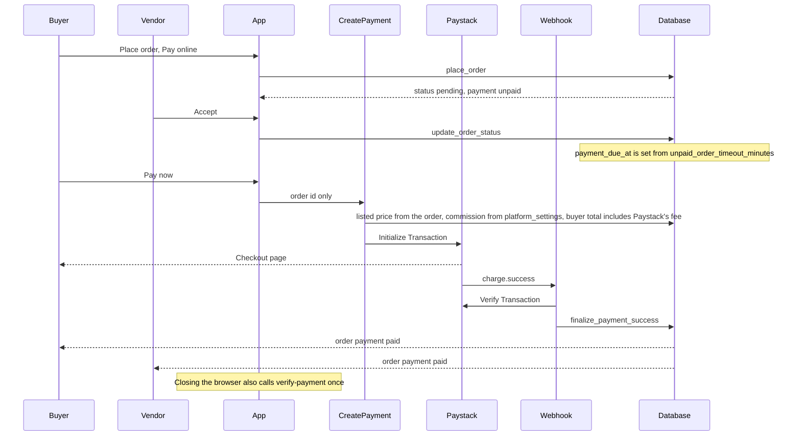

# Payments notes

Cash on delivery is unchanged for the buyer: they pay the listed price in cash. When that order is completed, the platform commission is recorded against the vendor and taken from a later online payout. Online payment is optional, in GHS, and only after the vendor accepts. The buyer pays the listed order total. Paystack's fee and the platform commission come out of the vendor's payout, and any waiting cash charges that fit are added to that payout. A subscription is not required. The app never decides that a payment succeeded, and it never sends an amount.

`npx tsc --noEmit` and `npx expo lint` both passed. The two-phone script below was not run from this pass.

## Flow

A cash order never enters this diagram. It stays `cash_on_delivery` and `unpaid`, and the vendor can mark it ready without a payment check.

## Order status and payment status

Cash on delivery uses the original status path. `payment_status` stays `unpaid`.

| From | Vendor can set | Buyer can set |
| --- | --- | --- |
| pending | accepted, rejected | cancelled |
| accepted | ready, cancelled | nothing |
| ready | completed | nothing |

Paystack uses the same order statuses. `payment_due_at` is set when the vendor accepts. These are the combinations the server actually allows.

| Order status | unpaid | pending | paid | failed | refund_pending | refunded |
| --- | --- | --- | --- | --- | --- | --- |
| pending | Placed. No Pay now yet. | Not used. Pay now is refused. | Not used. | Not used. | Not used. | Not used. |
| accepted | Pay now until `payment_due_at`. Vendor cannot mark ready. | Checkout started. Shown as confirming. A new Pay now is refused. | Vendor may mark ready. Cancel is refused. | Treated as still payable when the window is open. The failure path sets the order back to unpaid. | Support cancel only. | Refund finished. |
| ready | Blocked. Ready requires paid. | Blocked. | Normal pickup. Cancel is refused. | Blocked. | Support cancel only. | Refund finished. |
| completed | Not used. | Not used. | Finished. | Not used. | Support cancel only. | Refund finished. |
| rejected | Vendor declined before payment. | Not used. | Not used. | Not used. | Not used. | Not used. |
| cancelled | Buyer, vendor, or the timeout job. | A pending payment younger than 10 minutes stops the timeout job. | Not left in this cell. Admin cancel sets refund_pending. | Same as unpaid after a failed attempt. | Admin cancelled a paid order. | Paystack reported the refund processed. |

`failed` on the order is brief. `finalize_payment_failure` sets the order back to `unpaid` when it was `unpaid` or `pending`, and marks that payment row `failed` or `abandoned`.

## Functions

| Piece | Who calls it | What it does |
| --- | --- | --- |
| `place_order` | Signed-in buyer | Cash, or Paystack when the shop is verified and the total meets the minimum. Stores `unpaid`. |
| `update_order_status` | Buyer or vendor on that order | Same cash transitions. Paystack accept sets `payment_due_at`. Ready requires `paid`. Paid or `refund_pending` cannot be cancelled here. Buyer may cancel an accepted unpaid Paystack order. |
| `create-payment` | Buyer JWT | Checks the order, charges the listed total, and adds the commission plus any waiting cash charges to the platform's share. |
| `verify-payment` | Buyer JWT | Verifies the latest pending payment with Paystack, then finalizes it, or leaves it pending. |
| `paystack-webhook` | Paystack, `verify_jwt` false | Checks the signature, verifies `charge.success` with Paystack, and still handles verification-badge events. |
| `payments-sweep` | Cron, shared secret | Every 5 minutes, verifies pending payments older than 10 minutes and younger than 24 hours. Up to 10 per run. |
| `payout-account` | Vendor JWT | Lists Ghana banks, resolves an account name, then creates or updates that shop's subaccount. |
| `finalize_payment_success` | Service role only | Marks the payment and the order paid, or flags a duplicate or late payment for refund. |
| `finalize_payment_failure` | Service role only | Marks the payment failed or abandoned and returns the order to unpaid. |
| `auto_cancel_unpaid_orders` | Cron, every 5 minutes | Cancels accepted unpaid Paystack orders past `payment_due_at`, unless a payment is still pending from the last 10 minutes. |
| `admin_cancel_paid_order` | Admin | Cancels a paid order and sets `refund_pending`. |
| `get_public_payment_terms` | Signed-in user | Returns the commission percent and the online minimum only. |
| `orders_needing_refund` | Admin select | Rows in `refund_pending`, or with a payment flagged `needs_refund`. |

Deploy the payment functions with the commands in `supabase/README.md`. `create-payment`, `verify-payment`, `payments-sweep`, `paystack-webhook`, and `payout-account` need to be deployed before the phone tests can pass.

## Secrets

Set these on the Edge Functions, not in the app `.env`.

| Secret | Required | Purpose |
| --- | --- | --- |
| `PAYSTACK_SECRET_KEY` | Yes | Test key until the whole account moves to live. Also verifies the old `x-paystack-signature` header. |
| `PAYSTACK_PLAN_CODE` | Yes for the badge | Verification plan only. Not sent on order charges. |
| `PAYSTACK_WEBHOOK_SIGNING_SECRET` | Only if events send `Paystack-Signature` | The `whsec_...` value. Leave it unset while events still use `x-paystack-signature`. |
| `PAYMENT_RETURN_URL` | No | Optional `https://` page after checkout. Unset means Paystack shows its own finished page. |
| `PAYMENTS_SWEEP_SECRET` | Yes for the sweep | Same string as Vault secret `payments_sweep_secret`. |

## Paystack dashboard

Use the legacy dashboard. Test and live are separate: a test plan code does not work with a live secret key.

1. Settings, then API Keys & Webhooks. Copy the secret key for the mode you are in into `PAYSTACK_SECRET_KEY`.
2. Set the webhook URL in both test mode and live mode to `https://rktoeasjesopzapehrox.supabase.co/functions/v1/paystack-webhook`. One function handles order charges and the verification badge.
3. Leave the signing secret unset until a delivered event includes the `Paystack-Signature` header. Generate `whsec_...` under Developers, then API configuration, on the newer dashboard, and store it as `PAYSTACK_WEBHOOK_SIGNING_SECRET`. Do not delete the secret key while events still use the old header.
4. Enable Card and Mobile Money for GHS. Those are the channels behind "Pay online (mobile money or card)".
5. The vendor adds their bank account on My Shop. Paystack shows the account name, and after they confirm it an Edge Function creates the subaccount and saves the code. The account number is not stored. Test and live keys need their own subaccounts, so a test account must be added again after switching to the live secret key.
6. Live mode needs its own live secret key, live webhook on the same URL, live subaccounts, and a new live verification plan. Finish Paystack's own account checks before switching.

Test card that does not ask for a PIN: `4084084084084081`, any future expiry, CVV `408`. Test mobile money number listed as no PIN: `0551234987`. Use the numbers on Paystack's test payments page if those change.

## Test script

Two phones, Paystack test mode, one buyer and one approved vendor. The vendor's shop is verified, and `vendor_billing.subaccount_code` is filled for the split tests. Start from the defaults: commission 5, minimum GHS 25, timeout 30 minutes. Restore any setting you change.

1. Cash. Place an order with Cash on delivery. Vendor accepts, marks ready, and completes it. No Paystack page opens. Both phones show the same status changes.
2. Card. Place an online order at or above the minimum. Vendor accepts. Buyer taps Pay now and pays with the test card. Within a few seconds both phones show Paid, the vendor sees Paid online, and the chat shows "Payment received".
3. Mobile money. Repeat with the test mobile money number. Both phones show Paid.
4. Close early. Start Pay now and close the checkout before paying. The order must not show Paid. If Paystack still says the attempt is ongoing, the order stays confirming and Pay now stays unavailable. After Paystack reports the attempt abandoned, or after the sweep, the order is unpaid again and the buyer can pay.
5. Failure then retry. Use a Paystack failure test if one is listed. The order returns to unpaid, the buyer sees Try again, and a second successful payment shows Paid once.
6. Sweep. Leave a pending payment. The sweep looks at pending rows older than 10 minutes and younger than 24 hours, and cron runs every 5 minutes. For a faster check, set that row's `created_at` to 11 minutes ago in the SQL editor, wait for the next `payments-sweep`, and confirm the order becomes paid or unpaid from Paystack's verified status.
7. Replay. In the Paystack dashboard, resend the same `charge.success`. The second delivery returns 200. The order stays paid once. `payment_events` does not apply a second success.
8. Bad signature. POST `{}` to the webhook URL with `x-paystack-signature` set to `00`. The response is 401 and no order changes.
9. Mismatched amount. On a new pending payment, change `payments.amount_pesewas` in the SQL editor to a different positive number, then complete the test payment. `payment_events.result` is `mismatch`. The order's payment status does not become paid from that event. Put the amount back only if you are discarding the row.
10. Timeout. Before the vendor accepts, run `update public.platform_settings set value = '2'::jsonb where key = 'unpaid_order_timeout_minutes';`. Accept, do not tap Pay now, and wait until `payment_due_at` plus the next 5-minute cron. The order becomes cancelled. Restore the setting to `30`.
11. Buyer cancels an accepted unpaid order. The database allows this. The order screen does not show Cancel after accept, so this step does not pass in the app yet.
12. Vendor ready. On an accepted unpaid online order, Mark ready is disabled and says Waiting for payment. The database also rejects the change.
13. Paid cancel. On an accepted paid order, the vendor sees "Contact support to cancel a paid order" instead of Cancel, and that control opens the support link. The buyer does not get that control on the order screen.
14. Admin refund. As an admin, `select public.admin_cancel_paid_order('<order id>', 'test refund');`. The order is cancelled and `payment_status` is `refund_pending`. `select * from public.orders_needing_refund;` includes it.
15. Minimum. Build an online total under GHS 25, or the current `min_online_order_ghs`. Pay online is disabled and the minimum is shown with the price format. Cash still works.
16. No subaccount. Clear `subaccount_code` for a verified shop. The buyer can still choose Pay online, because the sheet only checks the verification badge. After accept, Pay now returns the message to choose cash or ask the vendor. Put the code back.
17. Vendor breakdown. After a successful online payment, the vendor sees the listed order total, platform charge, Paystack fee, and You receive. A completed cash order shows the platform charge and says it comes out of the next online payout. The buyer sees the listed total only.

## Assumptions and skipped

- A vendor adds a payout account on My Shop. `payout-account` resolves the account name, then creates or updates the Paystack subaccount and stores only `vendor_billing.subaccount_code`. The account number is not saved.
- The order sheet treats a verified, unpaused shop as ready for Pay online. The subaccount is checked only inside `create-payment`.
- No escrow. The split happens at payment time. Campus Plug does not take a cut of cash orders.
- Refunds are started in the Paystack dashboard. `refund.processed` sets the payment and the order to refunded. `refund.failed` leaves `refund_pending` and writes an audit row. `refund.pending`, `refund.processing`, and `refund.needs-attention` do not change the order.
- The buyer cannot cancel an accepted unpaid Paystack order from the screen, even though `update_order_status` allows it.
- "Contact support to cancel a paid order" is shown to the vendor when Cancel would have been on screen. It is not shown to the buyer.
- `create-payment` accepts only `payment_status = unpaid`. A checkout left in `pending` cannot be started again until failure handling or the sweep returns it to unpaid.
- The timeout job runs every 5 minutes, and it skips an order that has a pending payment created in the last 10 minutes. A 2-minute setting therefore does not cancel at exactly 2 minutes.
- Order rows are on Realtime. Payment rows are not. The phones update when the order row changes.
- Verification-badge charges still arrive on the same webhook and are not treated as order mismatches.
- `PAYMENT_RETURN_URL` is optional. Card and mobile-money details are never stored in the app.
