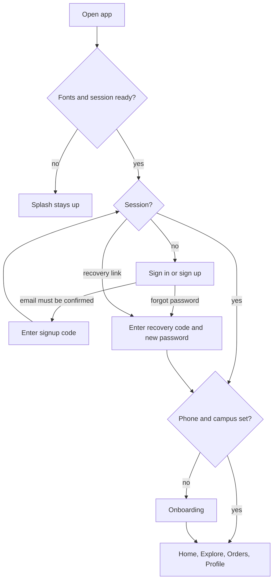

# Phase 2 notes

Campus Plug shell: dark navy and lime, auth, four tabs, and Profile. Home, Explore, and Orders are layout only. Marketplace data stays for a later phase.

## Token reference

Source: `src/constants/theme.ts`. `app.json` repeats `#061B36` for the splash and Android icon because native config cannot import TypeScript.

| Token | Value | Use |
| --- | --- | --- |
| background | `#061B36` | Screens |
| backgroundDeep | `#02132C` | Gradient end, tab bar |
| surface | `#0B2542` | Cards |
| surfaceAlt | `#162F52` | Fields, inactive chips |
| indigoDeep | `#17275F` | Selected rows |
| indigo | `#323CA1` | Tech badge |
| violet | `#5B33EE` | Pills, info |
| lilac | `#B07AEF` | Icons, links, avatar ring |
| periwinkle | `#8A93E8` | Inactive tabs. Eyeballed, a bit bright |
| border | `#2F3C8F` | 1px outlines. Eyeballed, stronger than the mock |
| primary | `#B5F94D` | Lime, prices, success |
| primaryPressed | `#9BDD34` | Pressed lime |
| textOnPrimary | `#101018` | Text on lime |
| textPrimary | `#F5F5F5` | Body text |
| textMuted | `#C2CAD3` | Subtitles |
| warning | `#FCCE51` | Pending, offline banner |
| danger | `#FF6B6B` | Errors. Not visible in the mockups |
| primarySoft | primary at 18% | Empty-state glow |
| overlay | black at 55% | Scrim |

Spacing: 4, 8, 12, 16, 20, 24, 32, 40, 48. Radius: 8, 12, 16, 20, pill. Layout: screen padding 20, touch target 44, tab bar 64, tab indicator 3, sell button 68.

Type: Plus Jakarta Sans for hero, wordmark, display, h1, h2, and price. DM Sans for body, button, caption, and eyebrow. `formatPrice` returns `GH₵35.00`. The cedi sign was not checked on a device.

`app.json` splash and adaptive-icon backgrounds stay `#061B36` because native config cannot import TypeScript.

## Components

`src/components/ui/`: Screen, AppHeader, ShellHeader, TabBar, PageHero, Button, IconButton, TextField, SearchBar, Card, SectionHeader, Chip (Pill), StatusPill, Badge, Avatar, ListRow, StatTile, EmptyState, LoadingScreen, Skeleton, InlineError, OfflineBanner, Icon.

`src/components/illustrations/`: Illustration, Blob, Curve, BrandWordmark.

`src/components/HighlightedTitle.tsx` paints one keyword in lime.

## Route map

| When | Route | What it shows |
| --- | --- | --- |
| Logged out | `/sign-in`, `/sign-up`, `/verify-email`, `/forgot-password` | Auth |
| Logged out, or a recovery session | `/reset-password` | Code, or the email link, then a new password |
| Session, missing phone or campus | `/onboarding` | Name, phone, hall / hostel / area |
| Session, profile complete | `/`, `/explore`, `/orders`, `/profile` | Tab shell |
| Same, hidden from the tab bar | `/notifications`, `/settings`, `/messages` | Placeholders |
| Vendor row | `/my-shop` | Placeholder. Others go back to Profile |
| `profiles.role = admin` | `/dashboard` | Placeholder. Others go home |

The center “+” is not a route. It alerts that selling opens in the next phase.

## Auth flow

## Files replaced or restyled

- `app.json`
- `src/app/_layout.tsx`
- `src/app/(auth)/sign-in.tsx`, `sign-up.tsx`, `forgot-password.tsx`
- `src/app/(auth)/verify-email.tsx` added
- `src/app/reset-password.tsx`, `src/app/onboarding.tsx`, `src/app/+not-found.tsx`
- `src/app/(tabs)/_layout.tsx`, `index.tsx`, `orders.tsx`, `messages.tsx`
- `src/app/(tabs)/explore.tsx`, `profile.tsx`, `notifications.tsx`, `settings.tsx`, `my-shop.tsx`, `dashboard.tsx` added
- Removed tab routes: `account.tsx`, `review.tsx`, `shop.tsx`
- `src/lib/auth.tsx` now re-exports `src/providers/AuthProvider.tsx`
- `src/lib/supabase.ts`, `src/components/AppErrorBoundary.tsx`

New support files: `src/constants/theme.ts`, `src/constants/config.ts`, `src/hooks/useAppFonts.ts`, `src/hooks/useNetworkStatus.ts`, `src/hooks/useUnreadCount.ts`, `src/hooks/useProfileStats.ts`, `src/lib/format.ts`, `src/lib/errors.ts`, `src/lib/validation.ts`.

`supabase/` and `types/` were not changed.

## Assumptions and skipped

- Illustration PNGs are not in the repo. Each name shows a tinted placeholder. See `assets/illustrations/README.md`.
- Periwinkle, border, and danger were eyeballed. Periwinkle is slightly bright. Border is stronger than the hairlines in the mock. Danger does not appear in the screenshots.
- Profile orders count rows where the user is the buyer or the vendor. Listings and Active show only when a vendor row exists. Active means `products.status = active`. A count of 0 is shown. A failed count is hidden.
- A profile is complete when phone and campus are set. The name is not required for that check.
- The explore mock’s center control is a bag. This shell uses the specified lime “+”.
- Home, Explore, and Orders do not load products, vendors, or orders. Messages, settings, My Shop, and Admin Dashboard are placeholders.
- No Wishlist and no Wallet.
- `SUPPORT_URL` is `EXPO_PUBLIC_SUPPORT_URL`. If it is empty, Support says the contact is coming soon.
- Sign-out does not deactivate a push token yet. That is marked for phase 5.
- The cedi glyph was not checked on a phone. This pass did not click through the app in a browser or on a device.

## Manual test script

1. Sign up, enter the email code, finish onboarding, and log out.
2. Log in. Try a wrong password and confirm the message is specific.
3. Reset the password with the emailed code. Open the app again and confirm the session is still there.
4. Turn on airplane mode and confirm the offline banner. Turn the network back on.
5. Insert an unread row in `notifications` for that user and confirm the bell dot. Open the bell and confirm the empty state.
6. On a small phone, check the tab bar and the “+” button. The button should say selling opens in the next phase.
7. Open Profile as a buyer. Approve a vendor row and confirm the check, role pill, and listing counts. Set `profiles.role` to `admin` in SQL and confirm the Admin card and dashboard. Set it back when finished.
