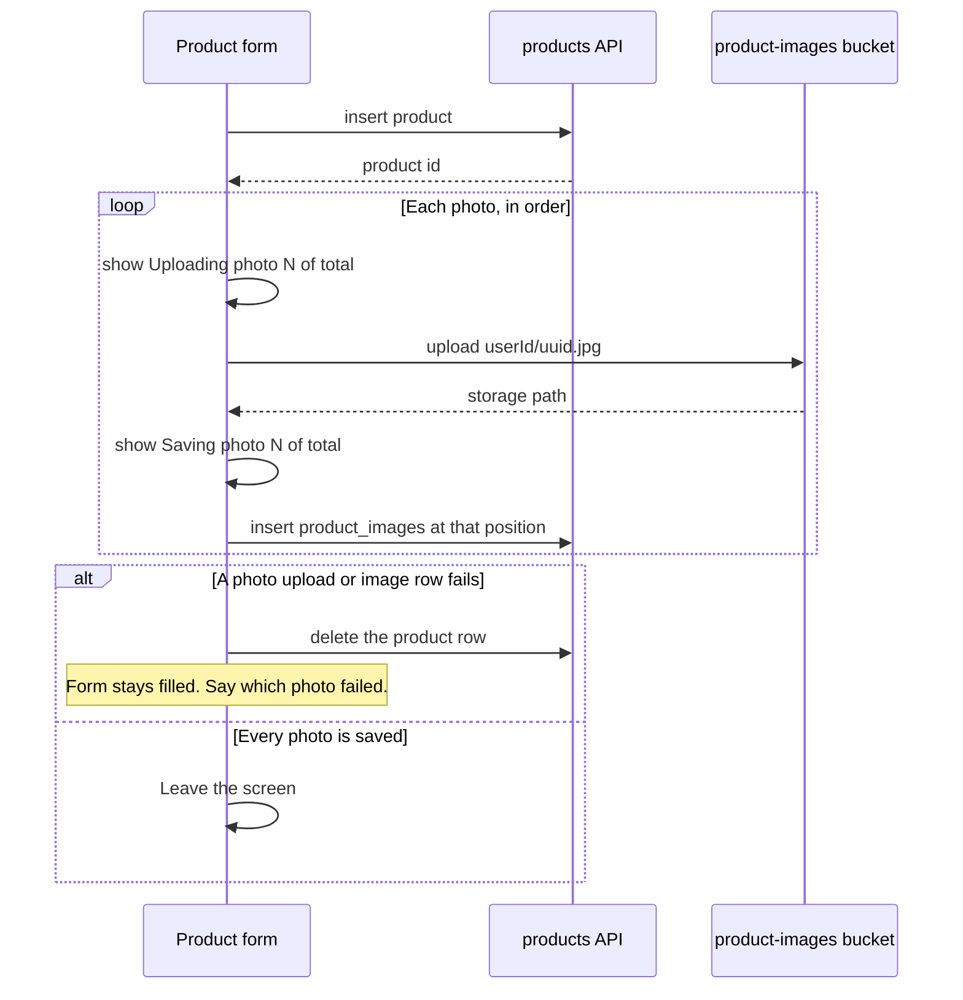

# Phase 3 notes

Marketplace browse and vendor tools. Buyers can find approved shops and active products. An approved vendor can apply, edit the shop, and list products with photos. Orders stay cash on delivery, in GHS. Chat, order placement, notifications, and admin review are later phases.

`npx tsc --noEmit` and `npx expo lint` both passed. This pass did not run the manual script on a phone.

## Routes

Visible tabs stay Home, Explore, Orders, and Profile. The other screens are hidden from the tab bar and keep it on screen.

| Route | Who | What it shows |
| --- | --- | --- |
| `/` | Signed in | Home: search, categories, promos, popular vendors |
| `/explore` | Signed in | Categories, new vendors, featured shop, just listed |
| `/search` | Signed in | Debounced search, filters, paged product grid |
| `/vendors` | Signed in | Public vendor grid |
| `/shop/[id]` | Signed in | Shop logo, name, description, active products |
| `/product/[id]` | Signed in | Photos, price, category, shop row, Chat to order |
| `/vendor/apply` | No vendor row | Shop name, description, optional logo |
| `/my-shop` | Any vendor row | Pending, rejected, removed, or the approved dashboard |
| `/vendor/edit-shop` | Approved vendor | Name, description, logo |
| `/vendor/product-form` | Approved vendor | Create, or edit when `id` is set |
| `/orders`, `/messages`, `/notifications`, `/settings`, `/dashboard` | As in phase 2 | Still placeholders |

The center **+** calls `sellEntry` in `src/lib/sell.ts`. No vendor row opens apply. Pending, rejected, or removed opens My Shop. Approved opens the product form. Home’s empty state and the “Start selling” promo use the same function.

Search accepts `sort` (`newest`, `price_asc`, `price_desc`, `relevance`) and `category` (a category slug). Explore accepts `category` as well.

## Query keys

Defined in `src/hooks/queries/keys.ts`. Lists use React Query with a 30 second stale time and one retry. Screens do not call Supabase directly.

| Key | Data |
| --- | --- |
| `['categories']` | Categories by `sort_order`, then name |
| `['vendors']` | Invalidation prefix |
| `['vendors', 'public']` | Approved shops that are not paused |
| `['vendors', 'own', userId]` | The signed-in user’s vendor row |
| `['vendors', 'detail', id]` | One shop, including a paused approved shop |
| `['products']` | Invalidation prefix for catalog changes |
| `['products', 'search', filters]` | `search_products`, 20 per page |
| `['products', 'detail', id]` | Product, images, category, and shop |
| `['products', 'by-vendor', vendorId, scope]` | `public` is active only. `owner` includes hidden and removed |
| `['products', 'covers']` | Latest cover path by vendor |
| `['products', 'home-meta']` | Cover, category, and product count for home cards |
| `['products', 'vendor-ids', categoryId]` | Vendors with an active product in that category |

Product create, update, delete, and image changes invalidate `['products']` and `['profile']`. Shop create and update invalidate `['vendors']` and call `refreshProfile()`. Returning to the app also reloads the profile and vendor row.

## Image pipeline

`src/lib/images.ts`.

1. `pickImages` asks for photo library access and returns up to the requested number of URIs.
2. `compressImage` resizes a product photo to 1200px wide, or a logo to 512px wide, then saves JPEG at quality 0.7.
3. `uploadImage` reads the file as an `ArrayBuffer`. An empty buffer or a file over 5,242,880 bytes is rejected. The object path is `{userId}/{uuid}.jpg` in `product-images` or `shop-logos`, with content type `image/jpeg`.
4. `getImageUrl` turns that stored path into the bucket’s public URL. A URL that is already public is left as-is.

The app never deletes storage objects. Deleting a product row cascades `product_images`. Database triggers queue cleanup for removed image rows and for a replaced shop logo. Replacing a logo only writes the new path.

Product photos are limited to 5. The first photo is the cover (`position` 0 on create).

## Product create flow

Edit sends only changed product fields. A new photo is uploaded and inserted. Removing a photo deletes that `product_images` row only. `removed_by_admin` shows `moderation_reason`, disables **Visible to buyers**, and still allows delete. Delete asks first. Leaving with unsaved changes asks first.

## Phase 2 files changed

- `app.json` — photo library message for product and shop pictures. Splash and icon stay `#061B36` because native config cannot import TypeScript.
- `package.json`, `package-lock.json` — `expo-crypto` and `expo-file-system`. The picker and image manipulator were already installed.
- `src/constants/theme.ts` — shop, product, image, and search limits, plus marketplace sizes.
- `src/constants/config.ts` — `FEATURED_VENDOR_ID`.
- `src/lib/errors.ts` — duplicate shop, permission, missing row, photo size, and check-constraint copy.
- `src/lib/validation.ts` — shop and product schemas. Empty descriptions become null.
- `src/components/ui/Icon.tsx` — icons used by categories, filters, and back buttons.
- `src/components/ui/Card.tsx` — optional padding.
- `src/components/ui/Screen.tsx` — pull to refresh.
- `src/components/ui/SearchBar.tsx` — optional autofocus.
- `src/components/ui/TextField.tsx` — optional multiline.
- `src/components/ui/TabBar.tsx` — **+** opens the sell flow.
- `src/components/illustrations/Illustration.tsx` — optional width.
- `src/providers/AuthProvider.tsx` — reload the vendor row when the app becomes active.
- `src/app/(tabs)/_layout.tsx` — hidden search, vendors, shop, product, and sell routes.
- `src/app/(tabs)/index.tsx`, `explore.tsx`, `my-shop.tsx` — replaced the phase 2 placeholders.

`supabase/` and `types/` were not changed.

## Assumptions and skipped

- `design/home.png` and `design/explore.png` are not in the repo. Layout follows the written spec and the existing tokens.
- `FEATURED_VENDOR_ID` is empty, so the Explore featured card stays hidden until an approved shop id is set.
- A rejected or removed shop cannot apply again. The client inserts only `status = 'pending'`, and the database allows one vendor row per owner. The screen shows the reason, or “This shop was removed”, plus contact-support text.
- Shop category, cover, and product count on home cards come from the latest 40 active products, not from a column on `vendors`. A shop can have a count and still miss a cover if it is outside that sample. Counts can also miss rows past the PostgREST row cap.
- “New” means the shop was created less than 7 days before the vendors module loaded. The clock is not read again on each render.
- `search_products` is granted to signed-in users. Buyers only receive active products from approved shops that are not paused, because of row-level security. The shop page does not query products while that shop is paused.
- The public product page is shown only when `status` is `active`. Hidden, removed, and missing products say the product is not available, including when the owner opens a hidden listing there. Edit stays on the product form.
- App checks are stricter than the database: shop name 3–40 characters, shop description up to 300, product title 2–80, product description up to 1000, and price greater than 0 up to 100000 with at most 2 decimals.
- If a new product’s photo fails, the product row is deleted and the form stays filled. A file that uploaded but never got an image row is left in storage. The client does not delete it. The same is true for a logo uploaded before a failed shop insert, and for a replacement photo whose image row fails on edit.
- **Chat to order** is disabled for an unavailable product and for the shop owner. A press only says ordering opens soon.
- No ratings, review counts, wishlist hearts, distance, or wallet. Orders, messages, notifications, settings, and the admin dashboard are still placeholders.
- The ArrayBuffer upload path was not verified on a device. This pass did not click through the app on a phone.

## Manual test script

Use two accounts. Account A sells. Account B buys. Run the SQL in the Supabase SQL editor as the database owner.

1. As A, with no vendor row, tap **+**, Home’s “Be the first to sell”, and the promo “Start selling”. Each opens apply.
2. Submit a shop with a logo. Confirm the “Application sent” screen, then My Shop says “Application under review”. Pull to refresh and tap **Check status**. It stays pending. Confirm there is no second apply button.
3. Approve A in SQL: `update public.vendors set status = 'approved' where owner_id = '<auth-user-uuid>';`. Return to the app, or tap **Check status**, and confirm the dashboard.
4. As A, add a product with 3 photos, a price, and a category. Confirm it appears on My Shop as Active and In stock.
5. Edit the title and description. Hide it with **Visible to buyers**. Turn **In stock** off. Confirm the public product page says it is not available.
6. Turn it visible and in stock again. Pause the shop and confirm the dialog. As B, confirm the shop and its products are gone from Home, Explore, and Search. Open the shop URL if you still have the id and confirm the paused banner and that products are not listed.
7. As A, unpause. As B, find the product from Home, Explore, and Search. Filter by its category and a price range that includes it, then one that excludes it. Sort by newest and by price. Open the product and the shop.
8. As A, delete the product and confirm it disappears for B.
9. Turn on airplane mode on Home, Explore, Search, Vendors, a shop, and My Shop. Confirm each list shows an error you can retry. Turn the network back on and retry.
10. Tap **+** with no vendor row, while pending, and after approval. Reject or remove the row in SQL and tap **+** again. Pending, rejected, and removed open My Shop. Rejected shows `rejection_reason` and does not offer a new application. Approved opens the product form.
