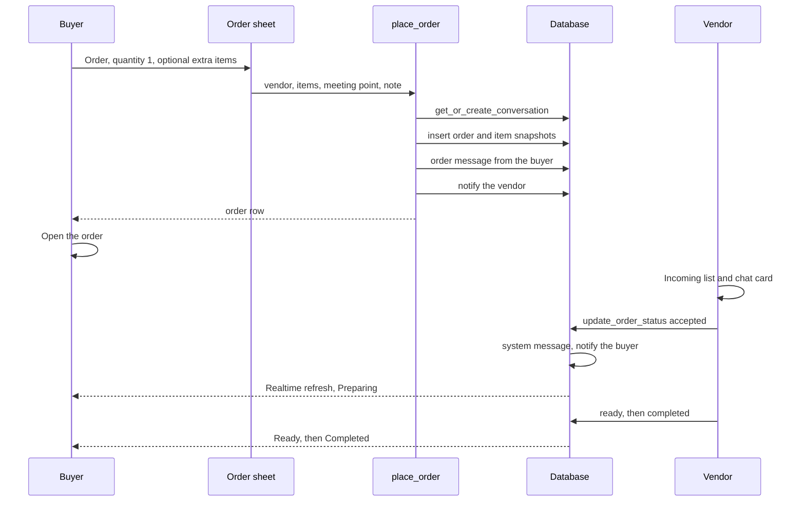

# Phase 4 notes

Orders and chat. A buyer places a cash-on-delivery order in GHS. The vendor moves it through preparing, ready, and completed. Both people can chat, and an order shows up in the thread as a card with the live status.

`npx tsc --noEmit` and `npx expo lint` both passed. This pass did not run the manual script on two phones.

## Routes

Visible tabs stay Home, Explore, Orders, and Profile. Order detail, chat, and messages stay hidden and keep the tab bar on screen.

| Route | Who | What it shows |
| --- | --- | --- |
| `/orders` | Signed in | My orders. Approved vendors also get Incoming. `segment=incoming` with a new `focus` value opens Incoming. |
| `/order/[id]` | Buyer or vendor on that order | Status, items, meeting point, note, counterpart, chat, and the actions that status allows |
| `/messages` | Signed in | Conversations, newest activity first |
| `/chat/[conversationId]` | A participant | Thread, composer, and for the buyer a link to the shop plus an order button |
| `/product/[id]` | Signed in | Chat button and lime Order. Unavailable, own listing, and paused shop stay blocked |
| `/shop/[id]` | Signed in | Message in the header, with the same own-shop and paused guards |
| `/my-shop` | Approved vendor | Incoming orders card, then the existing dashboard |
| `/profile` | Signed in | Messages row with the total unread count |

Order detail, product detail, the shop Message button, and Profile all open the same chat route. Placing an order closes the sheet and opens the new order.

## Query keys

Defined in `src/hooks/queries/keys.ts`. Lists use React Query with a 30 second stale time and one retry. Screens do not call Supabase directly.

| Key | Data |
| --- | --- |
| `['conversations']` | Invalidation prefix |
| `['conversations', 'list', userId]` | My conversations, counterpart, preview, unread count |
| `['messages']` | Invalidation prefix |
| `['messages', 'thread', conversationId]` | Infinite thread, 30 newest messages per page, older by `created_at` |
| `['orders']` | Invalidation prefix |
| `['orders', 'list', userId, role, filter]` | Buyer or vendor page, 15 rows, newest first |
| `['orders', 'detail', id]` | One order, items, counterpart, conversation id |
| `['orders', 'incoming-pending', userId]` | Count of pending orders where I am the vendor |

`place_order` invalidates `['orders']` and `['conversations']`. A status change invalidates `['orders']`, including when the database rejects the transition. Sending a text message updates the thread cache and invalidates `['conversations']`. Opening a chat and marking it read invalidate `['conversations']`.

## Realtime

`messages`, `conversations`, `orders`, and `notifications` are already in the `supabase_realtime` publication. The app does not subscribe to `notifications`. Row-level security still applies.

`useRealtimeChannel` subscribes only while the screen is focused and the app is in the foreground. Blur, background, and unmount remove the channel. The first time a channel name connects, it does not refetch. A later focus or a return to the foreground does. `CHANNEL_ERROR` or `TIMED_OUT`, followed by `SUBSCRIBED`, also refetches. `CLOSED` does not. Two mounted hooks must not use the same channel name. Supabase returns the existing channel, so the second subscriber would not get its own setup.

| Channel | Screen | Events | On change |
| --- | --- | --- | --- |
| `orders:${userId}` | Orders list and order detail, whichever is focused | `orders` where `buyer_id` is me, and where `vendor_user_id` is me | Invalidate `['orders']` |
| `conversations:${userId}` | Messages list | `messages` insert and update, plus `conversations` for me as buyer or vendor | Invalidate `['conversations']` |
| `messages:${conversationId}` | That chat | `messages` insert for this conversation | Merge the row into the thread by id |

The Orders tab badge reads `['orders', 'incoming-pending', userId]` and does not open its own channel. It updates when `['orders']` is invalidated, which happens while the orders list or an order detail is focused. Off those screens the badge waits for the next refetch. Profile uses the conversation query for its unread total and does not subscribe, for the same channel-name reason. The badge updates when that query is invalidated or refetched.

The open chat calls `mark_conversation_read` when it is focused, and again when a new message arrives while it stays focused. The call waits 500ms, and a newer message restarts that wait.

## Order flow

`place_order` writes an `order` message whose body is `Order placed for GHS ` plus the total, with `order_id` set. `update_order_status` writes a `system` message when `conversation_id` is still set: “Order accepted.”, “Order rejected.”, “Order ready for pickup.”, “Order completed.”, or “Order cancelled.” The status still changes if the conversation is gone. Clients may insert only `text` messages.

## Status

The database is the authority. The labels below are the UI mirror in `src/constants/orderStatus.ts`.

| Database | Label | Pill | Buyer | Vendor |
| --- | --- | --- | --- | --- |
| `pending` | Pending | pending | Cancel order | Accept, Decline |
| `accepted` | Preparing | preparing | | Mark ready, Cancel |
| `ready` | Ready | ready | | Mark completed |
| `completed` | Completed | completed | | |
| `rejected` | Declined | declined | | |
| `cancelled` | Cancelled | cancelled | | |

The timeline steps are Preparing, Ready, and Completed. Pending shows those steps as upcoming. Accepted and ready highlight the current step. Completed sits on the last step. Declined and cancelled replace the steps with one terminal line. List cards draw the timeline only for accepted and ready. Order detail always draws it. Destructive actions use the danger outline. Each action asks first. An illegal change says “This order changed. Showing the latest status.” and reloads the order.

List chips are All, Pending, Preparing (`accepted`), Ready, Completed, and Closed (`rejected` and `cancelled`). The item count on a card is the sum of quantities. “+ N more” counts extra lines. “Completed on” uses `updated_at`, because there is no status history table.

## Earlier files changed

- `src/constants/theme.ts` — message length, quantity, meeting point, note, and page sizes.
- `src/lib/errors.ts` — friendly copy for each order and chat database error.
- `src/lib/validation.ts` — message body and the order sheet.
- `src/lib/format.ts` — order date, time, and Today / Yesterday.
- `src/hooks/queries/keys.ts` — conversation, message, and order keys.
- `src/components/ui/Icon.tsx` — `minus` for the quantity stepper.
- `src/components/ui/Button.tsx` — `dangerOutline` for Decline and Cancel.
- `src/components/ui/TabBar.tsx` — pending incoming count on the Orders icon.
- `src/components/ui/ListRow.tsx` — optional unread badge.
- `src/app/(tabs)/_layout.tsx` — hidden order detail and chat routes.
- `src/app/(tabs)/orders.tsx` — replaced the placeholder.
- `src/app/(tabs)/messages.tsx` — replaced the placeholder.
- `src/app/(tabs)/product/[id].tsx` — chat button and Order.
- `src/app/(tabs)/shop/[id].tsx` — Message.
- `src/app/(tabs)/profile.tsx` — unread count on Messages.
- `src/app/(tabs)/my-shop.tsx` — Incoming orders card.

`supabase/` and `types/` were not changed. No migration was required.

## Assumptions and skipped

- Conversation previews come from the 100 newest messages the caller can see. The latest row per conversation is the preview. A database view would scale better. Unread counts read every visible message with `read_at` null whose sender is not me, up to the PostgREST row cap.
- The sheet is stricter than the database: meeting point 2–120 characters and required, note up to 300. The database allows a note of 500 and a meeting point of 200. Quantity is 1–50 per product. One order holds at most 50 lines. Duplicate product ids are summed on the server before that quantity check. An empty note is stored as an empty string.
- A chat order starts with no lines. The buyer adds at least one from that shop’s active, available products. The product page starts with that product at quantity 1.
- Own shop and a paused shop disable Order, the product chat button, and shop Message before the call. The product page still says “Currently unavailable”, “This is your listing”, or “This shop is paused”. The shop page says “This is your listing” and keeps the paused banner.
- Payment stays cash on delivery. The screens show that label and never show `payment_status`.
- A missing buyer or shop name is “Deleted user”. A null `conversation_id` says “Chat unavailable”. Counterpart people come from `public_profiles`. The shop name and logo come from the vendor embed, or from `shop_name_snapshot` when that embed is gone.
- Sending is disabled offline, with a banner on the composer. A failed text send stays in the thread and can be retried. There is no image send, typing indicator, or message edit or delete.
- Push registration, the notification inbox, admin moderation, ratings, and payments are later phases. The server still inserts notification rows. This phase only checks them in SQL.

## Manual test script

Use two phones. Account A buys. Account B is an approved vendor with at least two active products. Approve with `update public.vendors set status = 'approved' where owner_id = '<auth-user-uuid>';` if needed.

1. As A, open a product from B and add a second item in the sheet. Place the order with a meeting point. Confirm the sheet closes on the new order, the label is Cash on delivery, and the chat exists.
2. As B, confirm the order is under Incoming, the Orders tab badge counts it, and the chat shows an order card. In the SQL editor, `select * from notifications order by created_at desc limit 10;` shows the server rows.
3. As B, accept. As A, confirm Preparing updates without a manual refresh. Mark ready, then completed, and confirm A sees each step.
4. Place another pending order. As A, cancel it. Place one more. As B, decline it. Confirm both end as Cancelled and Declined, with no further actions.
5. Place one more pending order. As A, cancel it at the same time B accepts. The phone that loses shows “This order changed. Showing the latest status.” and the surviving status.
6. As B, open B’s own product and shop. Order, chat, and Message stay disabled, with the own-listing copy. Pause the shop and confirm A cannot order, with a clear paused message. Unpause.
7. As A, open the sheet, then as B mark that product out of stock before A submits. Confirm the friendly unavailable error.
8. Chat both ways. Confirm the other phone updates live, the unread badge appears on Messages and the conversation row, and it clears after the thread is opened.
9. Turn on airplane mode. Confirm send is disabled and the banner shows. Turn the network off in the middle of a send if you can, then retry the failed bubble. Open Orders, Messages, a thread, and a shop with airplane mode and confirm each list can retry.
