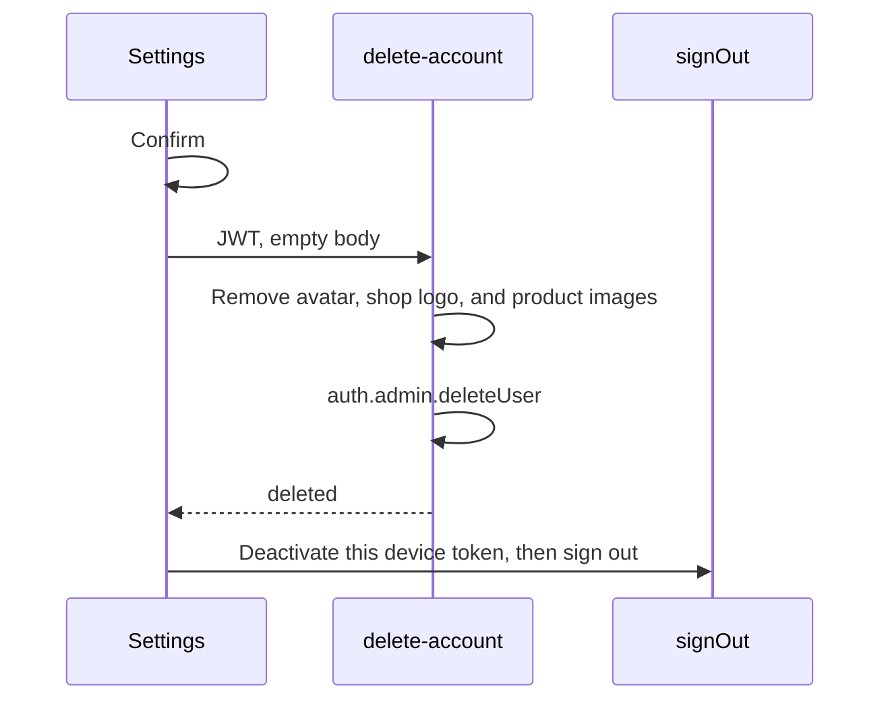

# Phase 5 notes

Profile, notification inbox, and push registration. Settings saves the name, phone, campus, and a profile photo, and the header shows that photo. The inbox lists server-created notifications, marks a row read, and opens the related order, chat, shop, or product. A development or production build can register a push token, and sign-out deactivates it. Expo Go skips push registration. Delete account confirms, calls the existing function, and signs out only after success.

`npx tsc --noEmit` and `npx expo lint` both passed. This pass did not run the manual script.

## Routes

Visible tabs stay Home, Explore, Orders, and Profile. Settings and the inbox stay hidden and keep the tab bar on screen. The header gear opens Settings. The header bell opens the inbox.

| Route | Who | What it shows |
| --- | --- | --- |
| `/settings` | Signed in | Name, phone, campus, profile photo, Save, and Delete account |
| `/notifications` | Signed in | Title, body, and time. Unread rows are highlighted. Pull to refresh and infinite scroll |
| `/order/[id]` | From `order_placed` or `order_status` when `data.order_id` is a string | The existing order screen |
| `/chat/[conversationId]` | From `message` when `data.conversation_id` is a string | The existing thread |
| `/my-shop` | From `vendor_reviewed` or `vendor_removed` | The existing shop screen |
| `/vendor/product-form` | From `product_moderated` when `data.product_id` is a string | That product, via `id` |

A tap marks the row read, then opens the destination. A missing id, or any other type, stays on the list after the row is marked read. An already-read row opens without another write. If marking read fails, the friendly error stays on the list and the screen does not navigate.

## Query keys

Defined in `src/hooks/queries/keys.ts`. The list uses React Query with a 30 second stale time and one retry. Screens do not call Supabase directly.

| Key | Data |
| --- | --- |
| `['notifications']` | Invalidation prefix for the list and the unread count |
| `['notifications', 'list', userId]` | Infinite list, 20 rows, newest `created_at` then `id` |
| `['notifications', 'unread', userId]` | Count of rows with `read_at` null. The header bell refetches this every 60 seconds |
| `['profile']` | Defined for later invalidation. Settings reloads the profile through `refreshProfile` and does not use this key |

Marking a row read invalidates `['notifications']`, so the list and the bell update together. The selected columns are `id`, `type`, `title`, `body`, `data`, `read_at`, and `created_at`. Push delivery columns stay off the client.

## Realtime

`notifications` was already in the `supabase_realtime` publication. The inbox is the only subscriber. The header bell does not open a channel.

`useRealtimeChannel` subscribes only while the inbox is focused and the app is in the foreground. Blur, background, and unmount remove the channel. The first time the channel name connects, it does not refetch. A later focus or a return to the foreground does. `CHANNEL_ERROR` or `TIMED_OUT`, followed by `SUBSCRIBED`, also refetches.

| Channel | Screen | Events | On change |
| --- | --- | --- | --- |
| `notifications:${userId}` | Notifications inbox | `INSERT` and `UPDATE` on `public.notifications` where `user_id` is me | Invalidate `['notifications']` |

## Push

`expo-notifications` is installed with `npx expo install` and listed in `app.json` plugins. No EAS build was created, and no Dashboard webhook was added.

Registration runs after sign-in, for iOS and Android, and only outside Expo Go (`isRunningInExpoGo` from `expo`). The app asks for permission. When it is granted, and `Constants.easConfig.projectId` or `extra.eas.projectId` is present, it reads the Expo push token and calls `register_push_token`. Android creates the `default` channel named Campus Plug before that call. Permission denied, Expo Go, web, a missing project id, or a thrown registration error is skipped quietly. The token this device stored is kept in memory.

Sign-out calls `deactivate_push_token` for that token, then `supabase.auth.signOut()`. If deactivation fails because the session is already gone (`not authenticated`), local sign-out still runs. Any other deactivation failure stays signed in so the token can be retried. Expo Go never stored a token, so sign-out only clears the session.

Expo Go cannot register a remote push token and cannot receive remote notifications on this SDK. The package still loads, so the dev server may print the Expo Go warning. That warning is expected. A development build is what actually registers.

## Delete account

The danger button sits under Save. `Alert.alert` explains that the profile, shop, products, and chats are removed, and past orders stay without the account name.

A storage failure stays on Settings with “Your photos could not be removed, so the account is still here.” and does not sign out. An account delete failure stays with “The account could not be deleted. Try again.” and does not sign out. Orders survive because their account foreign keys set null and the snapshots remain.

## Earlier files changed

- `src/constants/theme.ts` — notification page size of 20.
- `src/lib/errors.ts` — friendly copy for an invalid push token, a non-mobile platform, storage delete failure, and account delete failure.
- `src/hooks/queries/keys.ts` — notification list, unread count, and the unused profile prefix.
- `src/hooks/useUnreadCount.ts` — unread count through the API, refetch every 60 seconds, no channel.
- `src/app/(tabs)/settings.tsx` — profile form and Delete account.
- `src/app/(tabs)/profile.tsx` — avatar URL through `getImageUrl`.
- `src/components/ui/ShellHeader.tsx` — same avatar URL in the header.
- `src/components/ui/ListRow.tsx` — optional time on a row.
- `src/app/(tabs)/notifications.tsx` — replaced the placeholder.
- `src/providers/AuthProvider.tsx` — register after sign-in, deactivate before sign-out. The phase 5 TODO is gone.
- `app.json` — `expo-notifications` plugin.
- `package.json` and `package-lock.json` — `expo-notifications`.

New files: `src/lib/api/profile.ts`, `src/lib/api/notifications.ts`, `src/hooks/queries/useNotifications.ts`, `src/lib/push.ts`.

`supabase/` and `types/` were not changed. No migration was required.

## Assumptions and skipped

- Clients cannot insert notifications. Rows are created by the existing database triggers.
- The inbox reads `data` only when it is an object. `order_id`, `conversation_id`, and `product_id` must be strings. Anything else stays on the list.
- A development build still needs an EAS project id before a token can be stored. This repo has no `eas.json` and no `extra.eas.projectId`, so registration returns quietly until a build provides one.
- Phase 4 notes say the app does not subscribe to notifications. That was true at the end of phase 4. The inbox is now the only subscriber.
- No admin screens, ratings, payments, or in-app payment status. Cash on delivery and GHS stay as they were.
- The one-phone script below was not run. The phase 2 sign-in gate, the phase 3 two-account find, and the phase 4 two-phone order script are still open.

## Manual test script

Use one phone, signed in. For the inbox steps, this account should be an approved vendor so a new order notifies it. Place that order from a second account in the browser if you have one. Skip delete if you want to keep the account.

1. Open Settings from the header gear. Change the name and the photo, then Save. Confirm “Profile saved.”, then go back and confirm the header photo and the Profile photo match the new picture. The header name follows the saved name after the profile reloads.
2. As a buyer, place an order with this shop. On the phone, open the bell. Confirm a row with a title, a body, and a time, and that the unread row looks distinct.
3. Tap the order row. Confirm it opens that order, the row is no longer unread when you return, and the bell count drops without waiting 60 seconds.
4. If a message row exists, tap it and confirm the thread opens. A shop-review row opens My Shop. A product-moderation row opens that product form. A row with no id stays on the list.
5. Pull to refresh. With no rows, the title is “No notifications yet”.
6. Optional: Delete account, confirm, and confirm you land signed out. Past orders remain in the database without the account name. To keep this account, stop after step 5.
