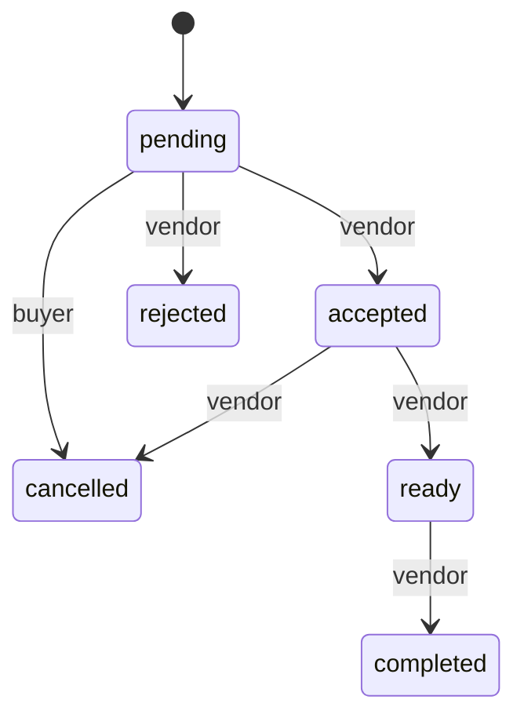
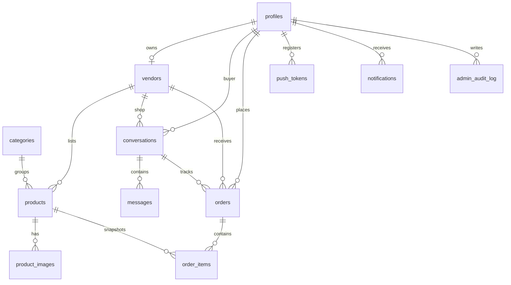

# Campus Plug backend

Hosted Supabase project for the Central University Ghana marketplace. Currency is GHS. Version 1 payment is cash on delivery.

## Setup

The project is linked. Apply the migrations, then load categories. `db push` does not run `seed.sql`.

```bash
npx supabase link --project-ref <project-id>
npx supabase db push
```

Run `supabase/seed.sql` in the SQL editor after the push.

Generate TypeScript types:

```bash
npx supabase gen types typescript --project-id <project-id> > types/database.types.ts
```

The app client is `src/lib/supabase.ts`. Copy `.env.example` to `.env` and fill in the project URL and anon key. Do not commit `.env`.

## Deploy functions

```bash
npx supabase functions deploy send-push
npx supabase functions deploy process-storage-cleanup
npx supabase functions deploy delete-account
```

## Environment variables and secrets

Never commit a secret. The service role key stays in the hosted function environment.

| Name | Where | Purpose |
| --- | --- | --- |
| `EXPO_PUBLIC_SUPABASE_URL` | app `.env` | Supabase API URL |
| `EXPO_PUBLIC_SUPABASE_ANON_KEY` | app `.env` | Public anon key |
| `SUPABASE_URL` | Edge Functions, injected | API URL |
| `SUPABASE_ANON_KEY` | Edge Functions, injected | Used by `delete-account` to read the user JWT |
| `SUPABASE_SERVICE_ROLE_KEY` | Edge Functions, injected | Bypasses RLS. Never put this in the app |
| `PUSH_WEBHOOK_SECRET` | `supabase secrets set` | `send-push` checks header `x-webhook-secret` |
| `CLEANUP_WEBHOOK_SECRET` | `supabase secrets set` | `process-storage-cleanup` checks the same header |

Vault secrets, created in the SQL editor. Use the same secret strings as the function secrets above.

```sql
select vault.create_secret('https://<project-ref>.supabase.co', 'project_url', 'API URL, no trailing path');
select vault.create_secret('<long random string>', 'push_webhook_secret', 'send-push shared secret');
select vault.create_secret('<long random string>', 'cleanup_webhook_secret', 'storage cleanup shared secret');
```

```bash
npx supabase secrets set PUSH_WEBHOOK_SECRET=<push_webhook_secret value>
npx supabase secrets set CLEANUP_WEBHOOK_SECRET=<cleanup_webhook_secret value>
```

Until those Vault rows exist, the cron jobs and the notification insert trigger do nothing. A notification insert then calls `send-push` for that row. `pg_cron` sweeps push every minute and storage cleanup every 10 minutes. Do not also add a Dashboard database webhook on `notifications`, or each insert sends twice.

## Roles

`public.profiles.role` is the only authorization source. Signup metadata is copied for the display name and is never read for access.

- New users are `buyer`.
- Approving a shop sets the owner to `vendor`.
- Removing a shop sets a `vendor` back to `buyer`. An `admin` who also owns a shop stays `admin`.
- Nothing in the client can change `role`.

Bootstrap the first admin in the SQL editor, using that person's auth user id:

```sql
update public.profiles
set role = 'admin'
where id = '<auth-user-uuid>';
```

## Order status



Any other change raises an error. The vendor is notified when an order is placed. The other party is notified on a status change, and a `system` message is added to the chat when the conversation still exists.

## Account deletion

Call the `delete-account` function with the user's JWT. It deletes the avatar, shop logo, and product images through the Storage API, then deletes the auth user.

Deleting the auth user deletes `public.profiles` (`ON DELETE CASCADE`). That removes the user's vendor, products, product images, conversations, messages, push tokens, and notifications.

Orders are kept for the other party. `orders.buyer_id`, `orders.vendor_id`, `orders.vendor_user_id`, and `orders.conversation_id` use `ON DELETE SET NULL`. `buyer_name_snapshot`, `shop_name_snapshot`, and each `order_items` title and price snapshot stay. The chat thread does not: a conversation is deleted when either participant's profile is deleted.

## Data model



`storage_cleanup_queue` has no foreign key. It holds bucket paths whose database row is gone but whose file still needs a Storage API delete. Deleting `storage.objects` does not delete the file.

Storage buckets `product-images`, `avatars`, and `shop-logos` are public, 5 MB, and image types only. Clients may write only under `{user_id}/...`.
